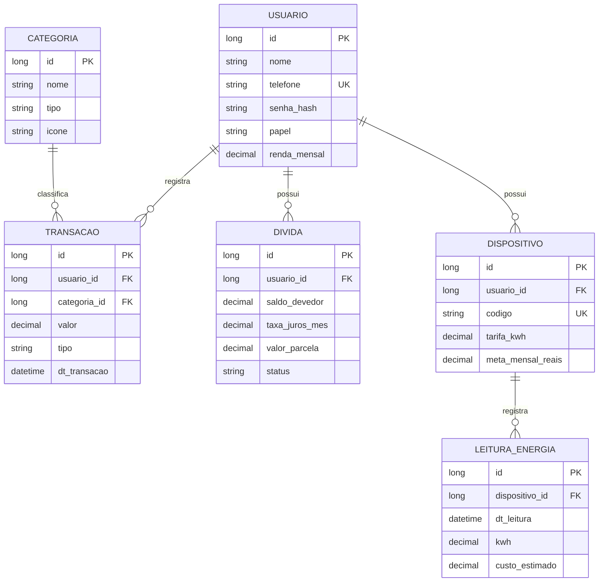

# Grana Amiga — API Java

API de finanças da Global Solution 2026/2. O Java cuida de contas, lançamentos, dívidas e consumo de energia. A API .NET do grupo cuida das trilhas e dos desafios educativos. Os simuladores de juros e poupança deste projeto fazem apenas cálculos; não armazenam jogos.

## Equipe

| Integrante | RM |
| --- | --- |
| Pedro Gonçalves Rodrigues | 567651 |
| Davi Isac Colin Pereira | 567265 |
| Hugo Souza de Jesus | 568542 |
| Matheus Peres Moraes de Jesus | 567300 |
| Cassio Ribeiro | 567295 |

**Antes da entrega:** incluir aqui o link do pitch e as credenciais de demonstração de um usuário USER e um ADMIN. O link público do GitHub deve ser entregue no arquivo .txt pedido pelo edital. Use apenas contas e senhas de teste.

## Tecnologias

Java 17, Spring Boot 4.1.1, Maven, Spring Web, Data JPA, Security, Validation, Cache, HATEOAS, Actuator e springdoc OpenAPI. As senhas usam BCrypt e a autenticação usa JWT. H2 permite executar e testar a API localmente.

## Executar

Requer JDK 17+ e Maven. Na raiz do projeto:

```bash
mvn spring-boot:run
```

A API sobe em `http://localhost:8080` e, por padrão, cria um banco H2 local em `data/`. A documentação interativa fica em `http://localhost:8080/swagger-ui.html`.

Para manter os tokens válidos após reiniciar, configure `APP_JWT_SECRET` no ambiente com pelo menos 32 bytes. Sem essa variável, a aplicação cria uma chave temporária.

Para testar e empacotar:

```bash
mvn test
mvn package
java -jar target/grana-amiga-api-1.0.0.jar
```

No Windows, `scripts/rodar-local.ps1 -Acao test` procura o JDK do IntelliJ e o Maven em cache quando não estão no PATH.

## Cadastro e acesso

`POST /api/v1/auth/cadastro` recebe nome, telefone, senha e renda mensal opcional. O telefone é normalizado; a senha fica armazenada como hash. Contas criadas pela API recebem o papel `USER`. `POST /api/v1/auth/login` devolve um JWT válido por duas horas. Envie `Authorization: Bearer <token>` nas rotas protegidas.

Para criar o ADMIN da demonstração, defina `APP_BOOTSTRAP_ADMIN_PHONE` e `APP_BOOTSTRAP_ADMIN_PASSWORD` antes de iniciar. Não há senha padrão. Se o papel de uma conta mudar, os tokens antigos são rejeitados e é necessário entrar novamente.

A API limita transações, dívidas e dispositivos ao dono da conta. Categorias podem ser consultadas sem login; alterações exigem ADMIN. O Actuator expõe `health` e `info` publicamente e `metrics` apenas para ADMIN.

## Rotas principais

| Recurso | Rotas |
| --- | --- |
| Autenticação | `POST /api/v1/auth/cadastro`, `POST /api/v1/auth/login` |
| Categorias | `GET /api/v1/categorias`; escrita por ADMIN |
| Lançamentos | CRUD em `/api/v1/transacoes`; filtros, `/extrato` e `/resumo` |
| Dívidas | CRUD em `/api/v1/dividas` e `GET /{id}/plano` |
| Energia | CRUD em `/api/v1/dispositivos`, leituras e resumo mensal |
| Simuladores | `POST /api/v1/educacao/simuladores/juros` e `/poupanca` |
| Conta | `DELETE /api/v1/usuarios/me` |
| Documentação | `/swagger-ui.html`, `/v3/api-docs`, `/actuator/health` |

O Swagger mostra os corpos de requisição e as respostas de cada rota. Erros de validação e regras de negócio usam o formato `instante`, `status`, `erro`, `mensagem` e, quando necessário, `campos`.

Exemplo de cadastro:

```bash
curl -X POST http://localhost:8080/api/v1/auth/cadastro \
  -H "Content-Type: application/json" \
  -d '{"nome":"Pessoa Teste","telefone":"11999990000","senha":"senha-de-teste-123","rendaMensal":2000.00}'
```

Depois, use o token retornado no botão **Authorize** do Swagger para registrar uma entrada ou saída em `/api/v1/transacoes` e consultar `/api/v1/transacoes/resumo?ano=2026&mes=11`. `rendaMensal` é apenas referência de planejamento: para entrar no saldo do mês, o valor precisa ser registrado como `ENTRADA`.

## Modelo de dados



Os vínculos são mapeados com `@ManyToOne(fetch = LAZY)`: os registros apontam para seu usuário, categoria ou dispositivo sem carregar automaticamente todos os dados relacionados. Não há remoção em cascata nessas associações. A exclusão de conta remove leituras, dispositivos, transações e dívidas explicitamente, na mesma transação, antes de remover o usuário.

## Consultas e cache

- **Derived query:** extrato por usuário e intervalo de datas.
- **JPQL:** totais mensais por categoria para montar o resumo.
- **Specification:** combina tipo, categoria, período e faixa de valor; listagens usam paginação e ordenação.
- **Cache:** Caffeine guarda categorias e resumos mensais. Alterações em categorias, lançamentos e exclusão de conta invalidam as entradas afetadas.

O banco de demonstração usa `ddl-auto: update`; não há migrações versionadas neste módulo. A integração oficial com WhatsApp, OCR, login por voz e biometria ainda não faz parte desta API.

## Estado desta versão inicial

O projeto foi importado do ZIP parcial em seis commits por assunto, em 11/11/2026. Os próximos ajustes devem continuar sendo versionados conforme forem realizados.

Pendências para a entrega final:

- Publicar o pitch e incluir o link neste README.
- Preparar contas de demonstração USER e ADMIN e documentar apenas credenciais de teste.
- Integrar o app Mobile e demonstrar o fluxo completo consumindo esta API.
- Preparar a configuração PostgreSQL e os containers com a frente de DevOps; esta versão usa H2.

## Uso de IA generativa

ChatGPT/Codex foi utilizado nesta revisão para comparar o ZIP com os requisitos, executar verificações e organizar a importação no GitHub. O grupo deve revisar o código, compreender as regras implementadas e complementar esta declaração com outros usos de IA feitos durante o desenvolvimento.

## Verificações realizadas em 11/11/2026

- Compilação e execução com JDK 17.0.21 e Maven 3.9.9.
- `mvn test`: 17 testes de integração aprovados, sem falhas, erros ou testes ignorados.
- `mvn -DskipTests package`: JAR executável gerado com sucesso.
- JAR iniciado e validado por HTTP: 27 verificações aprovadas, incluindo cadastro/login, JWT, USER/ADMIN, CORS, transações, saldo e invalidação do cache, dívidas, energia, HATEOAS, Swagger UI e Actuator. Os 19 caminhos da API foram encontrados no OpenAPI.

Os testes locais usaram H2 e contas descartáveis. A integração com Mobile, PostgreSQL, MQTT/Node-RED e Azure ainda precisa ser verificada em conjunto com as outras frentes.
