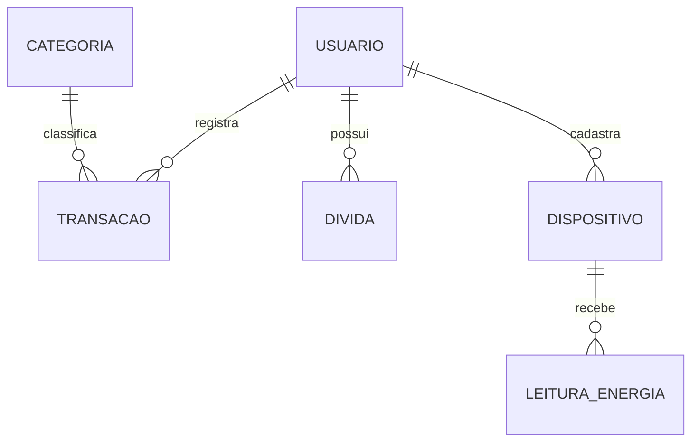

# Grana Amiga — API Java

API de educação e organização financeira desenvolvida para a Global Solution 2026/2. Este módulo cuida de contas, lançamentos, dívidas, consumo de energia e simuladores de juros e poupança. As trilhas e os desafios educativos ficam na aplicação .NET do grupo.

## Equipe

| Integrante | RM |
| --- | --- |
| Pedro Gonçalves Rodrigues | 567651 |
| Davi Isac Colin Pereira | 567265 |
| Hugo Souza de Jesus | 568542 |
| Matheus Peres Moraes de Jesus | 567300 |
| Cassio Ribeiro | 567295 |

Pitch: **adicionar o link do vídeo**.

## Tecnologias e organização

Java 25, Spring Boot 4.1.1, Maven Wrapper, Spring Data JPA, Spring Security, Bean Validation, Oracle Database, Caffeine, HATEOAS, Actuator e Swagger/OpenAPI. Os testes automatizados usam H2 em memória.

A aplicação segue o fluxo `controller → service → repository`. O pacote `model` agrupa entidades e records por funcionalidade (`usuario`, `categoria`, `transacao`, `divida`, `energia` e `educacao`); `security` contém a configuração do JWT; `config` reúne as configurações e os dados iniciais; `exception` trata os erros da API. As senhas são armazenadas com BCrypt.

## Modelo de dados



As seis entidades usam as tabelas e sequências correspondentes do Oracle. As associações são carregadas sob demanda (`LAZY`). Ao excluir uma conta, o serviço remove seus registros dependentes antes de excluir o usuário, sem exclusão em cascata automática.

## Como executar

Configure `JAVA_HOME` com um JDK 25 ou superior e defina `DB_USERNAME` e `DB_PASSWORD` com os dados da sua conta Oracle. A conexão padrão usa `oracle.fiap.com.br:1521/orcl`; para outro servidor, defina também `DB_URL` com a URL JDBC completa. Na pasta do projeto, execute:

Windows:

```powershell
.\mvnw.cmd spring-boot:run
```

Linux / macOS:

```bash
sh mvnw spring-boot:run
```

O Maven Wrapper usa a versão 3.9.16 do Maven e a baixa na primeira execução, se necessário.

A API fica em `http://localhost:8080` e o [Swagger](http://localhost:8080/swagger-ui.html) mostra as operações disponíveis. O banco é o Oracle da FIAP; as tabelas do grupo devem existir no usuário configurado, pois a API apenas valida o esquema ao iniciar.

Configure `APP_JWT_SECRET` com pelo menos 32 bytes para manter os tokens válidos entre reinícios. Para criar um `ADMIN`, defina `APP_BOOTSTRAP_ADMIN_PHONE` e `APP_BOOTSTRAP_ADMIN_PASSWORD` antes da primeira inicialização. Não há senha de administrador padrão.

## Usuários de teste

As contas fictícias abaixo já estão cadastradas no Oracle da FIAP, no esquema `RM567265`. Para usá-las, configure `DB_USERNAME=RM567265` e obtenha a senha do banco com o grupo. As senhas da tabela são apenas do aplicativo.

| Papel | Telefone | Senha do aplicativo | Demonstração |
| --- | --- | --- | --- |
| `USER` | `[TELEFONE_FORNECIDO_SEPARADAMENTE]` | `[CREDENCIAL_FORNECIDA_SEPARADAMENTE]` | Lançamentos, dívida, dispositivo e leitura de energia já cadastrados |
| `ADMIN` | `[TELEFONE_FORNECIDO_SEPARADAMENTE]` | `[CREDENCIAL_FORNECIDA_SEPARADAMENTE]` | Manutenção de categorias e consulta de `/actuator/metrics` |

Em outro esquema Oracle, crie um `USER` pelo cadastro e um `ADMIN` com as variáveis de bootstrap descritas acima. Essas contas de demonstração não são criadas automaticamente pelo projeto.

## Testar pelo Swagger

1. Abra `POST /api/v1/auth/login`, selecione **Try it out** e entre com a conta `USER` da tabela. Copie o token retornado.
2. Selecione **Authorize** no Swagger e informe o token. Consulte `GET /api/v1/transacoes`, `GET /api/v1/dividas` e `GET /api/v1/dispositivos` para ver os dados fictícios.
3. Consulte `GET /api/v1/categorias` e escolha o ID de uma categoria do tipo `SAIDA`. Registre um gasto em `POST /api/v1/transacoes` e consulte `GET /api/v1/transacoes/resumo` com o ano e o mês atuais.
4. Para conferir o perfil `ADMIN`, faça login com a outra conta e substitua o token em **Authorize**. Abra `GET /api/v1/categorias/{id}` e `GET /actuator/metrics`.

O cadastro público cria somente `USER`. A renda mensal é uma referência para planejamento; ela só entra no saldo quando registrada como transação do tipo `ENTRADA`. Para mostrar HATEOAS, consulte uma transação e observe os links `self`, `categoria`, `atualizar` e `excluir`. Com `ADMIN`, uma categoria também mostra links de manutenção. O resumo mensal usa cache: depois de adicionar, editar ou excluir uma transação, a consulta seguinte reflete a alteração. `GET /actuator/health` mostra a saúde da API.

## Endpoints

| Método | Caminho | Função |
| --- | --- | --- |
| POST | `/api/v1/auth/cadastro` | Criar conta `USER` |
| POST | `/api/v1/auth/login` | Receber JWT |
| GET | `/api/v1/categorias`, `/api/v1/categorias/{id}` | Consultar categorias sem login |
| POST | `/api/v1/categorias` | Criar categoria como `ADMIN` |
| PUT, DELETE | `/api/v1/categorias/{id}` | Atualizar ou excluir categoria como `ADMIN` |
| GET, POST | `/api/v1/transacoes` | Listar com filtros ou registrar lançamento |
| GET, PUT, DELETE | `/api/v1/transacoes/{id}` | Consultar, atualizar ou excluir lançamento |
| GET | `/api/v1/transacoes/extrato`, `/api/v1/transacoes/resumo` | Consultar extrato e resumo mensal |
| GET, POST | `/api/v1/dividas` | Listar ou cadastrar dívidas |
| GET, PUT, DELETE | `/api/v1/dividas/{id}` | Consultar, atualizar ou excluir dívida |
| GET | `/api/v1/dividas/{id}/plano` | Calcular plano de quitação |
| GET | `/api/v1/dividas/termometro` | Ver o comprometimento da renda com parcelas abertas |
| GET | `/api/v1/dividas/alertas` | Consultar próximos vencimentos; aceita `dataReferencia` e `dias` |
| GET, POST | `/api/v1/dispositivos` | Listar ou cadastrar dispositivos |
| GET, PUT, DELETE | `/api/v1/dispositivos/{id}` | Consultar, atualizar ou excluir dispositivo |
| GET, POST | `/api/v1/dispositivos/{id}/leituras` | Listar ou registrar leituras |
| GET | `/api/v1/dispositivos/{id}/leituras/{leituraId}` | Consultar leitura |
| GET | `/api/v1/dispositivos/{id}/resumo` | Consultar consumo e custo mensal |
| POST | `/api/v1/educacao/simuladores/juros`, `/api/v1/educacao/simuladores/poupanca` | Simular juros ou poupança sem login |
| GET | `/api/v1/usuarios/me` | Consultar perfil da conta autenticada |
| DELETE | `/api/v1/usuarios/me` | Excluir a conta e seus dados |

As rotas privadas usam `Authorization: Bearer <token>`. Lançamentos, dívidas e dispositivos são limitados ao dono da conta. O Actuator disponibiliza `health` e `info` publicamente; `metrics` exige `ADMIN`.

O termômetro divide a soma das parcelas de dívidas abertas pela renda mensal: até 30% é verde, até 50% é amarelo e acima disso é vermelho. Sem renda informada, a faixa é `SEM_RENDA`. Os alertas consideram os próximos 15 dias por padrão e ajustam vencimentos em dias 29 a 31 ao último dia de meses mais curtos.

## Consultas e cache

O extrato consulta lançamentos por usuário e período. Uma consulta derivada busca dívidas pelo usuário; o resumo usa JPQL para somar valores por categoria diretamente no banco. A listagem de lançamentos usa `Specification` para combinar filtros opcionais de tipo, categoria, datas e valor sem criar uma consulta para cada combinação, além de paginação e ordenação.

O Caffeine guarda categorias, que mudam pouco, e resumos mensais, que podem ser consultados várias vezes, por até cinco minutos. `@Cacheable` evita repetir essas consultas; `@CacheEvict` invalida os dados quando uma categoria ou transação é alterada.

## Gerar o JAR

Windows / PowerShell: `.\mvnw.cmd package`. Linux / macOS: `sh mvnw package`.

O arquivo gerado fica em `target/grana-amiga-api-1.0.0.jar` e pode ser executado com `java -jar target/grana-amiga-api-1.0.0.jar`.

## Testes

Execute `.\mvnw.cmd test` no Windows ou `sh mvnw test` no Linux/macOS. A suíte usa H2 em memória e não modifica o banco Oracle.
